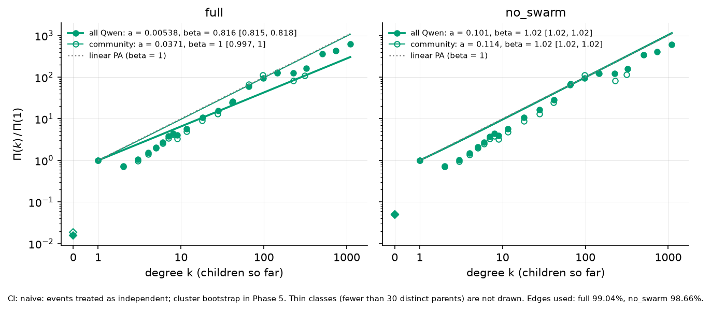

# Qwen pilot: attachment kernel on the Hugging Face genealogy

Pi(k)/Pi(1) and a first fit of (k + a)^beta for Qwen on the full and no_swarm versions, all Qwen models and community models only (official parents removed). The figure and every number below are generated by `rq2_growth/pilot_qwen.py` from the frozen v1 data.

## Fitted (a, beta)

Confidence intervals: naive: events treated as independent; cluster bootstrap in Phase 5.

| version | series | fit | a [lo, hi] | beta [lo, hi] | hits |
|---|---|---|---|---|---:|
| full | all | all_k | 0.00538 [0.00522, 0.00554] | 0.816 [0.815, 0.818] | 244,262 |
| full | all | k_ge_1 | 1e-06 [1e-06, 0.000309] (at bound) | 0.811 [0.81, 0.813] | 231,803 |
| full | community | all_k | 0.0371 [0.036, 0.0383] | 1 [0.997, 1] | 68,464 |
| full | community | k_ge_1 | 0.982 [0.914, 1.05] | 1.08 [1.07, 1.08] | 56,304 |
| no_swarm | all | all_k | 0.101 [0.0987, 0.104] | 1.02 [1.02, 1.02] | 174,849 |
| no_swarm | all | k_ge_1 | 0.345 [0.306, 0.385] | 1.03 [1.03, 1.03] | 162,390 |
| no_swarm | community | all_k | 0.114 [0.11, 0.117] | 1.02 [1.02, 1.02] | 68,464 |
| no_swarm | community | k_ge_1 | 0.982 [0.914, 1.05] | 1.08 [1.07, 1.08] | 56,304 |

The k_ge_1 rows are a diagnostic refit on degrees k >= 1 (D-20). Hits are the attachments used by the fit.

## Events per degree class

A class with fewer than 30 distinct parents is thin: it stays in the tables and the fit and is not drawn.

**full, all**

| k | events | distinct parents | thin |
|---|---:|---:|---|
| 0 | 12,459 | 240,106 | no |
| 1 | 7,421 | 12,675 | no |
| 2 | 4,048 | 7,425 | no |
| 3 | 2,706 | 4,045 | no |
| 4 | 2,012 | 2,693 | no |
| 5 | 1,615 | 2,008 | no |
| 6 | 1,369 | 1,613 | no |
| 7 | 1,218 | 1,362 | no |
| 8 | 1,075 | 1,206 | no |
| 9 | 974 | 1,079 | no |
| 10-14 | 3,775 | 975 | no |
| 15-22 | 4,127 | 635 | no |
| 23-34 | 4,356 | 442 | no |
| 35-52 | 4,743 | 317 | no |
| 53-79 | 5,625 | 233 | no |
| 80-119 | 6,833 | 188 | no |
| 120-179 | 8,355 | 156 | no |
| 180-269 | 10,408 | 124 | no |
| 270-404 | 11,666 | 104 | no |
| 405-607 | 13,121 | 74 | no |
| 608-911 | 15,120 | 59 | no |
| 912-1367 | 15,628 | 42 | no |
| 1368-2051 | 15,111 | 27 | yes |
| 2052-3077 | 14,430 | 18 | yes |
| 3078-4616 | 12,437 | 9 | yes |
| 4617-6925 | 12,195 | 7 | yes |
| 6926-10388 | 9,051 | 3 | yes |
| 10389-15583 | 10,390 | 2 | yes |
| 15584-23375 | 15,584 | 2 | yes |
| 23376-32534 | 16,410 | 2 | yes |

**full, community**

| k | events | distinct parents | thin |
|---|---:|---:|---|
| 0 | 12,160 | 239,719 | no |
| 1 | 7,167 | 12,378 | no |
| 2 | 3,813 | 7,165 | no |
| 3 | 2,486 | 3,810 | no |
| 4 | 1,803 | 2,474 | no |
| 5 | 1,412 | 1,800 | no |
| 6 | 1,175 | 1,413 | no |
| 7 | 1,027 | 1,166 | no |
| 8 | 892 | 1,022 | no |
| 9 | 790 | 894 | no |
| 10-14 | 2,913 | 791 | no |
| 15-22 | 2,844 | 469 | no |
| 23-34 | 2,598 | 289 | no |
| 35-52 | 2,320 | 174 | no |
| 53-79 | 2,336 | 104 | no |
| 80-119 | 2,506 | 72 | no |
| 120-179 | 2,812 | 56 | no |
| 180-269 | 3,350 | 41 | no |
| 270-404 | 2,717 | 30 | no |
| 405-607 | 2,392 | 16 | yes |
| 608-911 | 2,289 | 10 | yes |
| 912-1367 | 1,555 | 6 | yes |
| 1368-2051 | 1,368 | 2 | yes |
| 2052-3077 | 1,418 | 2 | yes |
| 3078-4616 | 1,539 | 1 | yes |
| 4617-5399 | 782 | 1 | yes |

**no_swarm, all**

| k | events | distinct parents | thin |
|---|---:|---:|---|
| 0 | 12,459 | 170,693 | no |
| 1 | 7,421 | 12,675 | no |
| 2 | 4,048 | 7,425 | no |
| 3 | 2,706 | 4,045 | no |
| 4 | 2,012 | 2,693 | no |
| 5 | 1,615 | 2,008 | no |
| 6 | 1,369 | 1,613 | no |
| 7 | 1,218 | 1,362 | no |
| 8 | 1,075 | 1,206 | no |
| 9 | 974 | 1,079 | no |
| 10-14 | 3,775 | 975 | no |
| 15-22 | 4,127 | 635 | no |
| 23-34 | 4,354 | 442 | no |
| 35-52 | 4,702 | 316 | no |
| 53-79 | 5,544 | 230 | no |
| 80-119 | 6,713 | 185 | no |
| 120-179 | 8,175 | 153 | no |
| 180-269 | 10,138 | 121 | no |
| 270-404 | 11,261 | 101 | no |
| 405-607 | 12,512 | 71 | no |
| 608-911 | 14,208 | 56 | no |
| 912-1367 | 14,260 | 39 | no |
| 1368-2051 | 13,059 | 24 | yes |
| 2052-3077 | 11,352 | 15 | yes |
| 3078-4616 | 7,820 | 6 | yes |
| 4617-6925 | 5,827 | 4 | yes |
| 6926-9051 | 2,125 | 1 | yes |

**no_swarm, community**

| k | events | distinct parents | thin |
|---|---:|---:|---|
| 0 | 12,160 | 170,306 | no |
| 1 | 7,167 | 12,378 | no |
| 2 | 3,813 | 7,165 | no |
| 3 | 2,486 | 3,810 | no |
| 4 | 1,803 | 2,474 | no |
| 5 | 1,412 | 1,800 | no |
| 6 | 1,175 | 1,413 | no |
| 7 | 1,027 | 1,166 | no |
| 8 | 892 | 1,022 | no |
| 9 | 790 | 894 | no |
| 10-14 | 2,913 | 791 | no |
| 15-22 | 2,844 | 469 | no |
| 23-34 | 2,598 | 289 | no |
| 35-52 | 2,320 | 174 | no |
| 53-79 | 2,336 | 104 | no |
| 80-119 | 2,506 | 72 | no |
| 120-179 | 2,812 | 56 | no |
| 180-269 | 3,350 | 41 | no |
| 270-404 | 2,717 | 30 | no |
| 405-607 | 2,392 | 16 | yes |
| 608-911 | 2,289 | 10 | yes |
| 912-1367 | 1,555 | 6 | yes |
| 1368-2051 | 1,368 | 2 | yes |
| 2052-3077 | 1,418 | 2 | yes |
| 3078-4616 | 1,539 | 1 | yes |
| 4617-5399 | 782 | 1 | yes |

## Edges used

- full: used 244,262 of 246,641 edges (99.0%); outside the window 2,094; first child of a delayed parent 231; same second as the parent's entry 54; undated child 0.
- no_swarm: used 174,849 of 177,228 edges (98.7%); outside the window 2,094; first child of a delayed parent 231; same second as the parent's entry 54; undated child 0.

## Window and inputs

Window: 2023-09-01T00:00:00Z to 2026-11-01T00:00:00Z (UTC). It starts at 00:00 UTC on the first day of the month of the first Qwen event (2023-09-27T10:52:38Z), so every hit has exposure before it inside the window; it ends after the last complete month before the snapshot.

Official list md5: `01d6d1243b17a5a6a1990ad15b636fac`.

## Caveats

- Confidence intervals: naive: events treated as independent; cluster bootstrap in Phase 5. Events cluster in bulk uploads and release days, so these intervals understate the uncertainty, and no difference between versions or series is tested here.
- Swarm: full and no_swarm differ. The full network holds automated adapter leaves attached to a few official hubs; read the high-k part of the full panel as those hubs. Community hits: full 68,464, no_swarm 68,464. The two counts are equal because the swarm hubs are official parents and leave the community series; its two versions differ only through the k = 0 exposure of the swarm leaves.
- k = 0: every Qwen model in the snapshot is there because it declared a parent, so the family pool of parents is complete and the models without children are known; k = 0 is part of the fit (D-14). The offset a is then largely set by the contrast between k = 0 and k = 1. Fitted a for all Qwen: full 0.00538 [0.00522, 0.00554]; no_swarm 0.101 [0.0987, 0.104]. The k_ge_1 rows refit on k >= 1 only (D-20): full 1e-06 [1e-06, 0.000309] (at bound); no_swarm 0.345 [0.306, 0.385]; when a sits on its lower bound the fit is close to a pure power of k.
- October 2026 stays in the window (D-08). In full: 2026-10 has 15,622 events, swarm share 0.0%, top uploader mradermacher (6.2%), 2,039 distinct parents, edge types finetune 34.9%, adapter 31.0%, quantized 31.6%, merge 2.5%, top parents Qwen/Qwen3.8-27B, Qwen/Qwen3.5-4B, Qwen/Qwen3.5-9B; 2026-09 for comparison has 11,388 events, swarm share 0.0%, top uploader mradermacher (6.0%), 1,477 distinct parents, edge types finetune 35.0%, adapter 29.7%, quantized 33.1%, merge 2.2%, top parents Qwen/Qwen3.8-27B, Qwen/Qwen3.5-9B, Qwen/Qwen3.5-4B.
- Dates: parents without a creation date: 6; parents dated after their first child: 228. Both kinds enter the pool at their first child's time and that first edge is not counted as a hit (D-04, D-05). Events on undated parents: 24; events whose child is older than its parent's recorded date: 312. The largest gap between a contradicted parent's date and its first child is 23.9 hours (within the one-day upload jitter the cleaning step already accepts).
- Wording: results are what the data are consistent with under this model, not statements about why models gain children; fitted a and beta describe the attachment kernel only.
- Freeze order: the official list was frozen after exploratory research prototypes that used the same uploader-only rule (official = a family model uploaded by the family's own org); the rule uses no outcome such as degree, downloads or likes, and it was not changed after seeing them. The list's provenance file records the same.
- Coverage: this pilot covers Qwen on the full and no_swarm versions only; quant_collapsed and the four matched base models come in Phase 5.

## Open questions for the team

- Is the uploader rule for official models what RQ1 and RQ3 use?
- Should mirrors such as unsloth re-uploads count as official in a sensitivity run (Phase 5)?
- Any objection to the window end 2026-11-01 and to the start at the family's first month?
- Which family should come next for the Phase 5 comparison?

## Run

`python rq2_growth/pilot_qwen.py` (after `python rq2_growth/freeze_official.py --check`).
